# driftfix

driftfix finds manual changes to AWS infrastructure and opens a pull request that updates the CloudFormation template to match.

<p align="center">
  
  <br><em>From a manual change to a pull request in six steps.</em>
</p>

## At a glance

| Question | Answer |
|---|---|
| What problem does it solve? | Someone changes a cloud resource by hand, and the template in Git no longer matches what is running. This is called drift |
| What does driftfix do? | It detects the change, asks an LLM to update the template, validates the result, and opens a pull request |
| What does it never do? | It never changes infrastructure and never merges a pull request. A person always decides |
| How does it run? | Once a day, as four AWS Lambda functions, for every customer |
| How well does it work? | In load tests it processed 10 stacks in parallel with no errors and no throttling |

Built by Abhishek Naresh Ahirrao, Kunal Elchipuram, and Ethan Machado. The project was first called the IaC Drift Reconciliation SaaS.

## Contents

1. [The problem](#1-the-problem)
2. [The system in one picture](#2-the-system-in-one-picture)
3. [Follow one change through the system](#3-follow-one-change-through-the-system)
4. [Design decisions](#4-design-decisions)
5. [Customer onboarding](#5-customer-onboarding)
6. [Test results](#6-test-results)
7. [Monitoring](#7-monitoring)
8. [Run it yourself](#8-run-it-yourself)
9. [Common questions](#9-common-questions)
10. [Known limitations](#10-known-limitations)
11. [Reference](#11-reference)
12. [Team](#12-team)

<details>
<summary>Terms used in this README</summary>

| Term | Meaning |
|---|---|
| Infrastructure as Code (IaC) | Describing cloud resources in files that are stored in Git, so that changes are reviewed and repeatable |
| CloudFormation | The AWS service that creates resources from a template file. A group of resources created together is a stack |
| Template | The file that describes the resources in a stack |
| Parameter file | A separate file that supplies values to a template, often one per environment, such as `prod.json` |
| Drift | A difference between the template and the resources that are running |
| CloudTrail | The AWS service that records every API call made in an account |
| cfn-lint | A tool that checks whether a CloudFormation template is valid |
| Amazon Bedrock | The AWS service that gives access to large language models (LLMs) |
| Tenant | One customer of driftfix |
| Dead-letter queue | A queue that holds work that failed, so that it can be inspected |
| P50 and P99 | P50 is the typical response time. P99 is the response time of the slowest 1% of requests |

</details>

---

## 1. The problem

Infrastructure as Code works on one assumption: the template in Git describes what is running in the cloud.

That assumption breaks when someone changes a resource by hand. Picture a production incident late at night. An engineer opens the AWS Console and resizes an instance from `t3.large` to `t3.xlarge`. The incident ends, and nobody updates the template.

<p align="center">
  
  <br><em>Git still says t3.large. AWS now runs t3.xlarge.</em>
</p>

This mismatch is drift. It causes no trouble until the next deploy. CloudFormation then reads the template, sees `t3.large`, and resizes the instance back down. The original problem returns, and the reason is hard to trace.

AWS can report that a stack has drifted. It does not write the fix. Someone still has to find what changed, edit the right file, and open a pull request. driftfix automates that work.

---

## 2. The system in one picture

<p align="center">
  
  <br><em>The complete AWS architecture. The moving dot follows one manual change from the customer's stack to a reviewed pull request.</em>
</p>

How to read the diagram:

| Part of the diagram | What it shows |
|---|---|
| Left side | What the customer owns: their AWS account, their GitHub repository, and the engineer who reviews pull requests |
| Right side | The driftfix AWS account, where all processing happens |
| Blue arrows | The path of one drift event, from the changed stack to the pull request |
| Numbers 1 to 4 | The four Lambda functions that make up the pipeline, in the order they run |
| Grey arrows | Supporting calls, such as reading a token or storing a file |
| Red dashed arrow | The retry that happens when a generated template fails validation |

The driftfix account reads from the customer's account through one read-only IAM role. It has no other access.

---

## 3. Follow one change through the system

This section follows the instance resize from section 1 through every step.

| Step | Where | What happens |
|---|---|---|
| 1 | Customer's AWS account | An engineer resizes the instance in the console. AWS runs the API call `ModifyInstanceAttribute` |
| 2 | CloudTrail | CloudTrail records the call and writes it to a log file in the customer's S3 bucket |
| 3 | EventBridge | At 07:00 UTC the daily schedule starts the Orchestrator |
| 4 | Orchestrator | It reads the last 72 hours of logs and keeps successful write calls. It skips calls made by CloudFormation itself, so a normal deploy is not treated as drift. It reads the `aws:cloudformation:stack-name` tag on the instance and learns that the instance belongs to the `web` stack |
| 5 | Stack Processor | It fetches `template.yaml` and the parameter files next to it from GitHub. It sends the files and the CloudTrail event to Amazon Bedrock, which returns an updated `prod.json` |
| 6 | Validator | It runs cfn-lint on the changed files. They pass |
| 7 | PR Creator | It commits the change on a `drift/...` branch and opens a pull request |
| 8 | Customer's GitHub | The team reviews the pull request the next morning |

The pull request looks like this:

> **[Drift] ModifyInstanceAttribute detected on web**
>
> | Field | Value |
> |---|---|
> | Stack | `web` |
> | Event | `ModifyInstanceAttribute` |
> | Time | 2026-01-10T07:00:00Z |
> | Actor | `arn:aws:iam::111111111111:user/alice` |
> | Model confidence | 82% |
>
> **What changed:** Instance resized to t3.xlarge.
>
> **Root cause:** Manual resize in the console.
>
> **Files updated:** `stacks/web/prod.json`

If the resize was correct, the team merges the pull request and Git matches AWS again. If it was a mistake, they close it and redeploy. In both cases the change is now visible.

---

## 4. Design decisions

Five decisions shape how driftfix behaves. Each one answers a question a careful reader would ask.

### 4.1 How are customers kept separate?

| Rule | How it works |
|---|---|
| Short-lived credentials | Each run calls STS `AssumeRole` and receives credentials that last one hour and work in one customer account |
| One `ExternalId` per customer | The role can only be assumed with a secret value created at onboarding, so one customer cannot point driftfix at another customer's account |
| Tokens in Secrets Manager | GitHub tokens are read at runtime and never written to logs or to the database |

### 4.2 Why does the model receive parameter files?

The value that drifted is often not in the template. Suppose `template.yaml` contains `InstanceType: !Ref Size` and `prod.json` sets `Size` to `t3.large`. The correct fix is one line in `prod.json`.

A model that sees only the template would write `t3.xlarge` directly into it, which would change every other environment too. driftfix sends both files, and the model returns only the files it changed.

### 4.3 What happens when the model returns an invalid template?

An LLM sometimes returns a template that is not valid CloudFormation. driftfix handles this as a normal case.

<p align="center">
  
  <br><em>The first attempt fails cfn-lint. The errors go back to the model, and the second attempt passes.</em>
</p>

When cfn-lint reports errors, the Validator sends the template back to the Stack Processor with the list of errors. The model receives its previous answer and the errors, and produces a corrected template.

The loop runs at most three times. If the template is still invalid, the events are marked `failed`, the invocation goes to a dead-letter queue, and an alarm fires.

Only cfn-lint errors block a template. Warnings are logged and ignored, because many hand-written templates already contain warnings that the model did not introduce.

### 4.4 What happens when the model is not sure?

The model returns more than a template. It also returns a summary, a root cause, a confidence score from 0 to 1, and a flag that asks for manual review. driftfix uses these to decide what to do:

| Model output | Result |
|---|---|
| A change with confidence of 0.6 or higher | A normal pull request that includes the model's explanation |
| A change flagged for manual review, or with confidence below 0.6 | A pull request marked `needs review` in its title, with a warning banner that lists the reasons |
| No change, because the evidence is not sufficient | No pull request. The reason is saved with the event |

The threshold is set by the `REVIEW_CONFIDENCE_THRESHOLD` environment variable on the Stack Processor.

### 4.5 How does it avoid losing or repeating work?

A daily batch job can fail in two ways: it can process the same event twice, or it can lose an event that failed. driftfix prevents both by keeping one record per CloudTrail event in DynamoDB.

<p align="center">
  
  <br><em>Three events with three outcomes. The failed event is retried on the next run and succeeds.</em>
</p>

| Status | Meaning | On the next run |
|---|---|---|
| `queued` | A run has picked up the event | Skipped, unless it has been queued for more than 2 hours |
| `pr_opened` | A pull request contains the fix | Skipped |
| `no_change` | The model found nothing to change | Skipped |
| `failed` | A stage reported an error | Retried, up to 3 attempts in total |

Failed events are retried on later runs, which is why the Orchestrator reads 72 hours of logs while running every 24 hours.

These rules are defined in [`lambdas/shared/reconciliation.py`](lambdas/shared/reconciliation.py). A step-by-step description of every stage is in [`docs/system-architecture.md`](docs/system-architecture.md).

---

## 5. Customer onboarding

Customers sign up through a web portal without help from the driftfix team.

<p align="center">
  
  <br><em>The four onboarding steps.</em>
</p>

The template in step 2 creates what driftfix needs in the customer's account: a CloudTrail trail that records write events, an S3 bucket for the logs, and the read-only role. The same resources are available as Terraform in [`terraform/customer/`](terraform/customer/).

The portal is a React front end ([`ui/customer-portal/`](ui/customer-portal/)) served by a FastAPI backend ([`admin_ui/app.py`](admin_ui/app.py)). It is packaged with Docker and hosted on AWS App Runner. The course deployment ran at `https://fxcbu33sqc.us-east-1.awsapprunner.com/portal/`. The guide for customers is [`docs/customer-onboarding.md`](docs/customer-onboarding.md).

---

## 6. Test results

| Finding | Evidence |
|---|---|
| Lambda scaled with the load | Concurrency matched the number of drifted stacks, from 1 to 10, with no throttles and no errors |
| The LLM is the bottleneck | Median Bedrock latency stayed between 4 and 5.5 seconds. The slowest 1% of calls grew to between 13.3 and 14.9 seconds at 10 stacks |
| One broken tenant did not affect the others | With an invalid tenant added, all 10 valid stacks still finished normally |
| No secrets appeared in the logs | A search of every Lambda log group for credential patterns found no matches |
| Failures are visible | Three deliberate failures each produced the expected signal in CloudWatch |

### 6.1 Load tests

On 2026-05-04 we ran five scenarios against a real AWS account with 10 CloudFormation stacks. A script created real drift by calling AWS APIs such as `PutBucketEncryption` and `ModifyDBInstance`, and we then started the Orchestrator manually.

| Scenario | Load | Question |
|---|---|---|
| T1 Functional | 1 stack | Does the pipeline work end to end? |
| T2 Scaling | 3 stacks | Do stacks run in parallel? |
| T3 Performance | 10 stacks | How fast is it at peak load? |
| T4 Failure | 10 stacks and 1 broken tenant | Does one bad customer block the others? |
| T5 Security | 6 stacks | Do any secrets appear in the logs? |

**Throughput.** More drifted stacks meant more Lambdas running in parallel, so throughput rose with load.

<p align="center">
  
  <br><em>Throughput for each scenario, ordered by load.</em>
</p>

**Latency.** The median Bedrock call (P50) stayed steady as load grew. The slowest 1% of calls (P99) did not, because parallel requests wait for model capacity.

<p align="center">
  
  <br><em>Bedrock latency as the number of parallel stacks increases.</em>
</p>

**Isolation.** In T4 we added a tenant with an invalid IAM role. The Orchestrator logged the error and continued.

**Security.** In T5 we searched every Lambda log group for `AKIA`, `ghp_`, `password`, `secret_key`, and `aws_secret`.

The full report and the raw CloudWatch exports are in [`results/report.md`](results/report.md).

### 6.2 Failure tests

Three scripts in [`tests/failure_scenarios/`](tests/failure_scenarios/) each cause one type of failure and check that the monitoring detects it.

| Scenario | What we did | Expected signal | Dead-letter queue |
|---|---|---|---|
| Poison pill | Sent the Validator a template with four cfn-lint violations | 3 Lambda errors and the `drift-detector-validator-errors` alarm | 1 message |
| Throttle | Sent 40 invocations against a concurrency limit of 10 | About 30 throttles and the `drift-detector-validator-throttled` alarm | About 10 messages |
| Degraded zone | Reduced the Validator's memory to slow it down, which imitates a struggling availability zone | Higher P99 duration with no errors | Empty |

Each scenario is described in [`tests/failure_scenarios/README.md`](tests/failure_scenarios/README.md).

### 6.3 Unit tests

The decision logic in the pipeline has unit tests that run without an AWS account. They cover which events count as drift, when an event is retried, how the model's reply is parsed, the cfn-lint retry loop, and the content of the pull request.

```bash
pip install boto3 pytest
```

```bash
pytest tests/unit
```

---

## 7. Monitoring

The pipeline runs once a day, so a failure could go unnoticed for many hours. A separate Health Check Lambda runs every 5 minutes. It checks each Lambda function, both DynamoDB tables, the audit bucket, and the dead-letter queue, and publishes a `drift-detector/HealthCheck` metric for each one. A value of `1` means healthy, and `0` triggers an alarm.

| Dashboard | Shows |
|---|---|
| `drift-detector-status` | Whether every component is healthy right now |
| `drift-detector-overview` | Invocations, errors, P95 and P99 duration, throttles, cold starts, and concurrency |
| `drift-detector-cost` | Estimated Lambda cost for the selected time range |

There are 17 alarms: 8 for component health and 9 for pipeline behaviour such as errors, throttles, timeouts, and dead-letter queue depth. All alarms send notifications through SNS. More detail is in [`docs/observability.md`](docs/observability.md).

---

## 8. Run it yourself

You need an AWS account with access to a Bedrock model, Terraform 1.5 or newer, and an S3 bucket for the Lambda zip files.

1. Package the Lambdas and upload them:

   ```bash
   ./scripts/package_lambdas.sh <your-lambda-zip-bucket>
   ```

2. Copy `terraform/saas/terraform.tfvars.example` to `terraform.tfvars` and fill in the values.

3. Deploy:

   ```bash
   cd terraform/saas && terraform init && terraform apply
   ```

The four pipeline Lambdas invoke each other, so deploy them together.

The diagrams and charts in this README are generated by a script. To change them, edit the script and run it again:

```bash
python docs/diagrams/generate.py
```

---

## 9. Common questions

| Question | Answer |
|---|---|
| Can driftfix change my infrastructure? | No. Its role in your account is read-only, and its only output is a pull request |
| What access does it need? | Read access to the CloudTrail log bucket, permission to read CloudFormation templates and resource tags, and a GitHub token that can write contents and pull requests on one repository |
| How is this different from CloudFormation drift detection? | CloudFormation tells you that a stack has drifted. driftfix writes the template change, and the pull request shows who made the manual change and when |
| Which AWS services can it trace back to a stack? | S3, EC2, RDS, Lambda, IAM roles, SNS, SQS, and DynamoDB. The list is in [`lambdas/processor/stack_resolver.py`](lambdas/processor/stack_resolver.py) |
| Does it fix Terraform code? | No. It updates CloudFormation templates and their parameter files |
| How soon does a pull request appear? | After the next daily run at 07:00 UTC |
| Which model does it use? | Amazon Nova Lite by default. Set `BEDROCK_MODEL_ID` to use another Bedrock model |
| What if the model is wrong? | Invalid templates are sent back for correction. Low-confidence changes are marked `needs review`. Every change still needs a person to merge it |

---

## 10. Known limitations

driftfix started as a course project. These parts are not ready for production:

| Limitation | Effect |
|---|---|
| The portal has no login | Anyone who can reach the portal can list, add, and remove tenants. It needs authentication before it is exposed to the internet |
| Templates outside GitHub | If the template is not in the customer's repository, driftfix uses the copy stored by CloudFormation and proposes it as `template.yaml` in the repository root, which may be the wrong location |
| Tenants are processed in sequence | All tenants share one 15-minute Orchestrator run, which limits how many customers a run can serve |
| No CI | The unit tests are run manually |

---

## 11. Reference

<details>
<summary>AWS services used</summary>

| Service | Purpose |
|---|---|
| AWS Lambda | The four pipeline functions and the health check |
| Amazon Bedrock | The LLM that rewrites templates. The default model is Nova Lite |
| AWS CloudTrail | The log of every API call in the customer's account |
| Amazon DynamoDB | `drift-detector-tenants` stores customer configuration. `drift-detector-reconciliations` stores one record per event |
| Amazon S3 | CloudTrail logs in the customer's account and validated templates in the driftfix account |
| Amazon EventBridge | The daily trigger, `cron(0 7 * * ? *)`, and the 5-minute health check schedule |
| Amazon SQS | The dead-letter queue for failed invocations |
| Amazon CloudWatch and SNS | Dashboards, alarms, metric filters, and notifications |
| AWS Secrets Manager | GitHub tokens |
| AWS STS and IAM | Cross-account access with temporary credentials, and one role per Lambda |
| AWS App Runner and Amazon ECR | Hosting and the image registry for the customer portal |
| Terraform | Defines all of the above in [`terraform/`](terraform/) |

</details>

<details>
<summary>Repository layout</summary>

```
.
├── lambdas/
│   ├── processor/          Orchestrator: reads CloudTrail, finds drift, fans out per stack
│   ├── stack_processor/    Fetches the template, calls Bedrock, decides what to do with the answer
│   ├── validator/          Runs cfn-lint and drives the retry loop
│   ├── pr_creator/         Commits the changed files and opens the pull request
│   ├── health_check/       Probes every component every 5 minutes
│   └── shared/             Event status lifecycle, packaged into every Lambda
├── admin_ui/               FastAPI backend for the customer portal
├── ui/customer-portal/     React + Vite + Tailwind front end
├── terraform/
│   ├── saas/               driftfix's own infrastructure, dashboards and alarms
│   └── customer/           What a customer deploys: CloudTrail, S3, cross-account role
├── tests/
│   ├── unit/               Unit tests, no AWS needed
│   ├── e2e.py              End-to-end test against a deployed pipeline
│   └── failure_scenarios/  The three break-it-on-purpose scripts
├── scripts/
│   ├── package_lambdas.sh  Builds and uploads the Lambda zips
│   └── load_test/          Load test runner and graph generation
├── results/                Load test report, graphs G1 to G7, raw metric exports
├── docs/                   Architecture, onboarding and observability guides
│   └── diagrams/           README diagrams and charts, the AWS icons, and the script that draws them
├── Dockerfile              Portal image: React build + FastAPI
└── .env.example
```

</details>

---

## 12. Team

Built by Abhishek Naresh Ahirrao, Kunal Elchipuram, and Ethan Machado.

<details>
<summary>Who did what</summary>

### Abhishek Naresh Ahirrao

- Designed the end-to-end multi-tenant SaaS architecture with idempotency and tenant isolation as core constraints.
- Designed the four-stage asynchronous Lambda pipeline, EventBridge scheduling, DynamoDB deduplication, S3 handoff, and SQS DLQ flow.
- Authored and deployed the Terraform configuration covering Lambda, IAM, DynamoDB, SQS, CloudWatch, and EventBridge.
- Created architecture diagrams illustrating the two-account topology, pipeline sequence, and concurrency fan-out.
- Wrote the architecture, scaling, and cost analysis sections of the technical report.
- Designed cross-account IAM using STS AssumeRole with ExternalId protection and per-invocation session renewal.

### Kunal Elchipuram

- Designed and implemented the customer-facing onboarding portal frontend, including the onboarding forms and guided customer setup flow.
- Updated the customer onboarding CloudFormation template to support self-service tenant onboarding.
- Dockerized the customer portal application and deployed it through Amazon ECR and AWS App Runner.
- Executed the five structured load test scenarios covering functional correctness, scaling, failure isolation, security, and performance.
- Collected, analyzed, and presented the performance metrics used in the report and presentation, including latency, throughput, concurrency, and resource utilization.
- Experimented with and evaluated different Amazon Bedrock models for deployment suitability.
- Configured the Bedrock integration in the Stack Processor Lambda for LLM-based CloudFormation template generation.
- Helped write the related components in the report and presentation slides.

### Ethan Machado

- Created the example customer repository, including the CI/CD pipeline and CloudFormation test stacks.
- Created and executed the dedicated failure scenarios.
- Created three CloudWatch dashboards for service status, operations overview, and cost visibility.
- Implemented CloudWatch alarms and the SNS email notification topic.
- Implemented recurring health checks for major pipeline components.
- Implemented write-only management log filtering on the customer tenant side.
- Created and collaborated on several presentation slides.
- Presented the introduction, customer-side system demo, and failure scenario sections.
- Helped write the Abstract, Problem Definition, Motivation, Related Work, Implementation Details, Failure Modeling, Architectural Trade-Off Analysis, and Conclusions sections of the final report.

</details>
