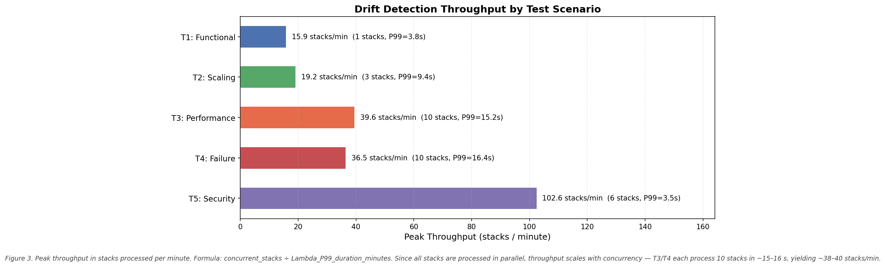
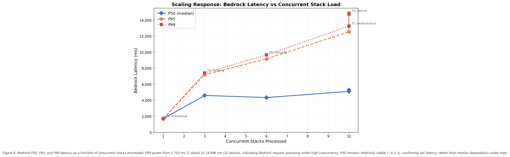

# driftfix

### Your cloud changed. Your code didn't. driftfix opens the pull request that closes the gap.

<p align="center">
  
  <br><em>The whole idea in ten seconds. Every diagram on this page is animated; give them a moment.</em>
</p>

*A project by Abhishek Naresh Ahirrao, Kunal Elchipuram, and Ethan Machado. Originally built as the "IaC Drift Reconciliation SaaS".*

---

## It starts with a quick fix

It is late, production is struggling, and an engineer does the sensible thing: opens the AWS Console and bumps the instance from `t3.large` to `t3.xlarge`. The graphs recover. Everyone goes to bed.

Nobody touches the CloudFormation template.

<p align="center">
  
  <br><em>Git still says t3.large. AWS now says t3.xlarge.</em>
</p>

That gap has a name: **drift**. The template in Git is supposed to describe what is running, and now it doesn't.

Drift is easy to live with until the next deploy. CloudFormation reads the template, sees `t3.large`, and helpfully shrinks the instance back. The incident you fixed three weeks ago returns, and this time nobody remembers why.

AWS can tell you *that* a stack has drifted. What it won't do is write the fix. Someone still has to work out what changed, find the right file, edit it, and open a pull request. That chore is exactly the kind people skip, so we automated it.

## What driftfix does

Once a day, for every customer, driftfix does three things.

**It detects.** It reads the customer's CloudTrail logs, which record every API call made in their account, and picks out the manual changes to resources that CloudFormation manages.

**It fixes.** It hands the template and the evidence to an LLM on Amazon Bedrock and asks for an updated template that matches what is now running.

**It proposes.** It checks the result with cfn-lint and opens a pull request explaining what changed and why.

Then it stops. driftfix never touches your infrastructure and never merges anything. A person reads the pull request and decides.

### What lands in your repo

The morning after that late-night resize, the team that owns the stack finds this waiting:

> **[Drift] ModifyInstanceAttribute detected on web**
>
> | Field | Value |
> |---|---|
> | Stack | `web` |
> | Event | `ModifyInstanceAttribute` |
> | Time | 2026-01-10T07:00:00Z |
> | Actor | `arn:aws:iam::111111111111:user/alice` |
> | Model confidence | 82% |
>
> **What changed** — Instance resized to t3.xlarge.
>
> **Root cause** — Manual resize in the console.
>
> **Files updated:** `stacks/web/prod.json`

If the resize was right, merge it and Git matches reality again. If it was a mistake, close it and redeploy. Either way, the change is no longer invisible.

---

## Under the hood

### Two accounts and a very narrow door

driftfix serves many customers, so the first design question was how to read from someone else's AWS account without being able to do anything else there.

<p align="center">
  
  <br><em>Follow the dot: one manual change travelling from the customer's account to a pull request.</em>
</p>

The answer is one read-only IAM role in the customer's account, and three rules around it:

- **Credentials expire.** Every run asks AWS STS for fresh credentials that last one hour and work in exactly one customer's account.
- **Each customer has a secret handshake.** The role can only be assumed with an `ExternalId` generated at onboarding. Without it, one customer could trick driftfix into reading another's account.
- **Tokens stay locked up.** GitHub tokens live in AWS Secrets Manager and are fetched at the moment they are needed. They never appear in logs or in the database.

### Four small Lambdas, one job each

The pipeline is a relay. Each function does one thing and passes the baton.

**1. The Orchestrator finds the manual changes.** It reads the last 72 hours of CloudTrail logs and keeps only successful write calls. It also throws away anything CloudFormation did itself, because a normal deploy changes resources too and must not be mistaken for drift. For each change that remains, it reads the resource's `aws:cloudformation:stack-name` tag to learn which stack owns it.

**2. The Stack Processor writes the fix.** One copy runs per affected stack, all in parallel. It pulls the template from the customer's GitHub repo, along with the parameter files sitting next to it, and sends the lot to Bedrock with the CloudTrail events.

**3. The Validator checks the fix.** It runs cfn-lint on whatever the model produced.

**4. The PR Creator proposes the fix.** It commits every changed file in a single commit on a `drift/...` branch and opens the pull request.

> **Why send parameter files too?** Because the value that drifted often isn't in the template. If `template.yaml` says `InstanceType: !Ref Size` and `prod.json` says `Size = t3.large`, the right fix is one line in `prod.json`. A model that can only see the template would hard-code `t3.xlarge` there and quietly break every other environment.

### The model will sometimes be wrong

LLMs occasionally produce a template that is not valid CloudFormation. We treat that as an ordinary event, not a crash.

<p align="center">
  
  <br><em>First attempt fails cfn-lint. The errors go back to the model, and the second attempt passes.</em>
</p>

When cfn-lint finds errors, the Validator sends the template back to the Stack Processor together with the error list. The model sees its own rejected answer and what was wrong with it, and tries again.

This can happen three times. If the template is still broken after that, the events are marked `failed`, the invocation lands in a dead-letter queue, and an alarm goes off so a human can look.

One detail matters more than it seems: only cfn-lint **errors** block a template. Warnings are logged and ignored, because real hand-written templates are full of warnings the model had nothing to do with.

### The model says how sure it is, and we listen

Along with the template, the model returns a short explanation, a confidence score from 0 to 1, and a flag for "a human should look closely at this". driftfix behaves differently depending on the answer:

| The model says | What happens |
|---|---|
| "Here is the change" with confidence of 0.6 or more | A normal pull request, with the model's explanation in the description |
| "Here is the change, but check it", or confidence under 0.6 | A pull request titled **`[Drift – needs review]`** that opens with a warning banner |
| "I can't tell what to change from this evidence" | **No pull request.** The reason is recorded and nobody is bothered |

That last row matters more than it looks. A tool that opens a pull request every time, including when it has nothing useful to say, teaches people to ignore its pull requests.

### No event gets lost, and none is handled twice

A daily batch job has two classic ways to go wrong: doing the same work twice, and silently dropping work that failed. driftfix avoids both by giving every CloudTrail event a small record in DynamoDB.

<p align="center">
  
  <br><em>Three events, three endings. The red one fails, waits for the next daily run, and succeeds on the retry.</em>
</p>

Finished events are skipped on later runs, so the same pull request is never opened twice. Failed events are picked up again the next day, up to three attempts. That is why the Orchestrator looks back 72 hours when it only runs every 24: yesterday's failures need to still be in view.

The whole rulebook is one short file, [`lambdas/shared/reconciliation.py`](lambdas/shared/reconciliation.py). For a step-by-step walkthrough of every stage, see [`docs/system-architecture.md`](docs/system-architecture.md).

---

## Getting a customer on board

Customers sign themselves up through a small web portal. No support ticket, no call.

<p align="center">
  
  <br><em>Four steps, and the customer does all of them without us.</em>
</p>

The template from step 2 creates everything driftfix needs on the customer's side: a CloudTrail trail that records write events, an S3 bucket for the logs, and the read-only role. If a customer prefers Terraform, the same resources are in [`terraform/customer/`](terraform/customer/).

The portal is a React front end ([`ui/customer-portal/`](ui/customer-portal/)) served by a FastAPI backend ([`admin_ui/app.py`](admin_ui/app.py)), packaged with Docker and hosted on AWS App Runner. The course deployment ran at `https://fxcbu33sqc.us-east-1.awsapprunner.com/portal/`. The customer-facing guide is [`docs/customer-onboarding.md`](docs/customer-onboarding.md).

---

## Did it actually work?

We tested it two ways: by loading it up, and by breaking it on purpose.

### Loading it up

On 2026-05-04 we pointed driftfix at a real AWS account holding 10 CloudFormation stacks, then caused real drift with a script that called AWS APIs directly (`PutBucketEncryption`, `ModifyDBInstance` and friends).

**It scaled without us doing anything.** One drifted stack meant one Lambda running. Ten meant ten, with zero throttles and zero errors. Throughput rose from about 16 stacks a minute to about 39.5.



**The slow part is the LLM, not our code.** The typical Bedrock call took 4–5 seconds whether we ran one stack or ten. The unlucky calls were another story: the slowest 1% went from 1.7 seconds with one stack to 14.9 seconds with ten, as parallel requests queued for model capacity.



**One broken customer doesn't sink the rest.** We added a tenant with an invalid IAM role. The Orchestrator logged the error and moved on; all ten healthy stacks finished normally.

**No secrets in the logs.** We searched every Lambda log group for `AKIA`, `ghp_`, `password`, `secret_key` and `aws_secret`. Nothing.

<details>
<summary>The five load test scenarios</summary>

| Scenario | Stacks | The question it answers |
|---|---|---|
| T1 — Functional | 1 | Does the whole pipeline work end to end? |
| T2 — Scaling | 3 | Do stacks really run in parallel? |
| T3 — Performance | 10 | How fast is it at peak load? |
| T4 — Failure | 10 + 1 broken tenant | Does one bad customer block the others? |
| T5 — Security | 6 | Do any secrets leak into the logs? |

Drift was induced with [`scripts/load_test/run_load_test.sh`](scripts/load_test/run_load_test.sh). The full report, all seven graphs and the raw CloudWatch exports are in [`results/report.md`](results/report.md).

</details>

### Breaking it on purpose

A system that only works when nothing goes wrong isn't finished. Three scripts in [`tests/failure_scenarios/`](tests/failure_scenarios/) each cause one specific failure and check that the monitoring notices.

| What we broke | What we expected | What landed in the dead-letter queue |
|---|---|---|
| **Poison pill.** Sent the Validator a template with four cfn-lint violations | 3 Lambda errors and the `validator-errors` alarm | 1 message |
| **Throttle.** Fired 40 invocations at a concurrency limit of 10 | About 30 throttles and the `validator-throttled` alarm | About 10 messages |
| **Degraded zone.** Starved the Validator of memory to imitate a struggling availability zone | Slower responses, but zero errors | Nothing |

Each one is written up in [`tests/failure_scenarios/README.md`](tests/failure_scenarios/README.md).

### Watching it in production

A job that runs once a day can be broken for 23 hours before anyone notices. So a separate health check runs every 5 minutes, probing each Lambda, both DynamoDB tables, the audit bucket and the dead-letter queue. Each gets a `1` (healthy) or `0` (alarm) in CloudWatch.

Three dashboards sit on top: `drift-detector-status` for "is everything up?", `drift-detector-overview` for performance, and `drift-detector-cost` for spend. Seventeen alarms notify through SNS. The details are in [`docs/observability.md`](docs/observability.md).

---

## Try it yourself

**Run the tests.** The pipeline's decision logic has unit tests that need no AWS account:

```bash
pip install boto3 pytest
```

```bash
pytest tests/unit
```

**Deploy it.** You need an AWS account with Bedrock model access, Terraform 1.5 or newer, and an S3 bucket to hold the Lambda zip files. Package and upload the Lambdas:

```bash
./scripts/package_lambdas.sh <your-lambda-zip-bucket>
```

Copy `terraform/saas/terraform.tfvars.example` to `terraform.tfvars`, fill it in, then:

```bash
cd terraform/saas && terraform init && terraform apply
```

The four pipeline Lambdas pass work to each other, so always deploy them together.

**Redraw the diagrams.** They are generated by a script, so they are easy to change:

```bash
python docs/diagrams/generate.py
```

---

## What we'd fix next

This began as a course project, and we would rather tell you where the edges are than have you find them.

- **The portal has no login.** Anyone who can reach it can list, add and remove tenants. It needs authentication before it faces the internet.
- **Templates that aren't in GitHub.** If driftfix can't find the template in the customer's repo, it falls back to CloudFormation's copy and proposes it as `template.yaml` at the repository root, which may not be where the customer keeps it.
- **Customers are processed one after another** inside a single 15-minute Orchestrator run, which caps how many one run can serve.
- **No CI yet.** The unit tests are run by hand.

---

## Reference

<details>
<summary>Every AWS service and what it does here</summary>

| Service | What it does here |
|---|---|
| **AWS Lambda** | The four pipeline functions plus the health check |
| **Amazon Bedrock** (Nova Lite by default) | The LLM that rewrites templates from CloudTrail evidence |
| **AWS CloudTrail** | The source of truth: a log of every API call in the customer's account |
| **Amazon DynamoDB** | `drift-detector-tenants` holds customer config; `drift-detector-reconciliations` holds one record per event |
| **Amazon S3** | CloudTrail logs on the customer side; validated templates on the driftfix side |
| **Amazon EventBridge** | The daily trigger, `cron(0 7 * * ? *)`, and the 5-minute health check schedule |
| **Amazon SQS** | Dead-letter queue for failed invocations |
| **Amazon CloudWatch + SNS** | Dashboards, alarms, metric filters, and alarm notifications |
| **AWS Secrets Manager** | GitHub tokens |
| **AWS STS + IAM** | Cross-account access with temporary credentials; one role per Lambda |
| **AWS App Runner + Amazon ECR** | Hosting and image registry for the customer portal |
| **Terraform** | All of the above, defined in [`terraform/`](terraform/) |

</details>

<details>
<summary>Repository layout</summary>

```
.
├── lambdas/
│   ├── processor/          Orchestrator: reads CloudTrail, finds drift, fans out per stack
│   ├── stack_processor/    Fetches the template, calls Bedrock, decides what to do with the answer
│   ├── validator/          Runs cfn-lint and drives the retry loop
│   ├── pr_creator/         Commits the changed files and opens the pull request
│   ├── health_check/       Probes every component every 5 minutes
│   └── shared/             Event status lifecycle, packaged into every Lambda
├── admin_ui/               FastAPI backend for the customer portal
├── ui/customer-portal/     React + Vite + Tailwind front end
├── terraform/
│   ├── saas/               driftfix's own infrastructure, dashboards and alarms
│   └── customer/           What a customer deploys: CloudTrail, S3, cross-account role
├── tests/
│   ├── unit/               Unit tests, no AWS needed
│   ├── e2e.py              End-to-end test against a deployed pipeline
│   └── failure_scenarios/  The three break-it-on-purpose scripts
├── scripts/
│   ├── package_lambdas.sh  Builds and uploads the Lambda zips
│   └── load_test/          Load test runner and graph generation
├── results/                Load test report, graphs G1–G7, raw metric exports
├── docs/                   Architecture, onboarding and observability guides
│   └── diagrams/           The animated README diagrams and the script that draws them
├── Dockerfile              Portal image: React build + FastAPI
└── .env.example
```

</details>

## Team

Built by Abhishek Naresh Ahirrao, Kunal Elchipuram, and Ethan Machado.

<details>
<summary>Who did what</summary>

### Abhishek Naresh Ahirrao

- Designed the end-to-end multi-tenant SaaS architecture with idempotency and tenant isolation as core constraints.
- Designed the four-stage asynchronous Lambda pipeline, EventBridge scheduling, DynamoDB deduplication, S3 handoff, and SQS DLQ flow.
- Authored and deployed the Terraform configuration covering Lambda, IAM, DynamoDB, SQS, CloudWatch, and EventBridge.
- Created architecture diagrams illustrating the two-account topology, pipeline sequence, and concurrency fan-out.
- Wrote the architecture, scaling, and cost analysis sections of the technical report.
- Designed cross-account IAM using STS AssumeRole with ExternalId protection and per-invocation session renewal.

### Kunal Elchipuram

- Designed and implemented the customer-facing onboarding portal frontend, including the onboarding forms and guided customer setup flow.
- Updated the customer onboarding CloudFormation template to support self-service tenant onboarding.
- Dockerized the customer portal application and deployed it through Amazon ECR and AWS App Runner.
- Executed the five structured load test scenarios covering functional correctness, scaling, failure isolation, security, and performance.
- Collected, analyzed, and presented the performance metrics used in the report and presentation, including latency, throughput, concurrency, and resource utilization.
- Experimented with and evaluated different Amazon Bedrock models for deployment suitability.
- Configured the Bedrock integration in the Stack Processor Lambda for LLM-based CloudFormation template generation.
- Helped write the related components in the report and presentation slides.

### Ethan Machado

- Created the example customer repository, including the CI/CD pipeline and CloudFormation test stacks.
- Created and executed the dedicated failure scenarios.
- Created three CloudWatch dashboards for service status, operations overview, and cost visibility.
- Implemented CloudWatch alarms and the SNS email notification topic.
- Implemented recurring health checks for major pipeline components.
- Implemented write-only management log filtering on the customer tenant side.
- Created and collaborated on several presentation slides.
- Presented the introduction, customer-side system demo, and failure scenario sections.
- Helped write the Abstract, Problem Definition, Motivation, Related Work, Implementation Details, Failure Modeling, Architectural Trade-Off Analysis, and Conclusions sections of the final report.

</details>
