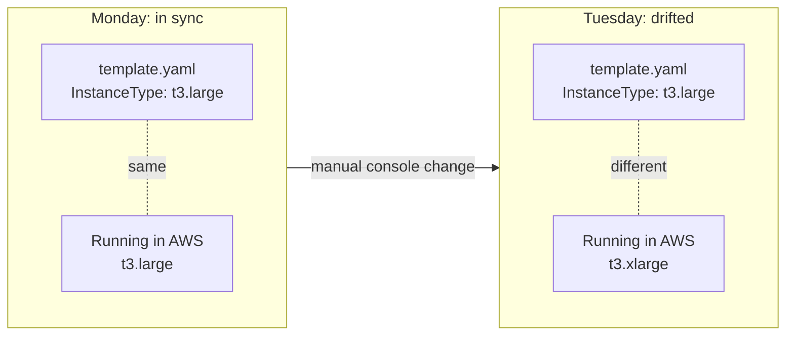
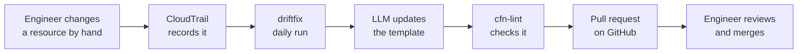
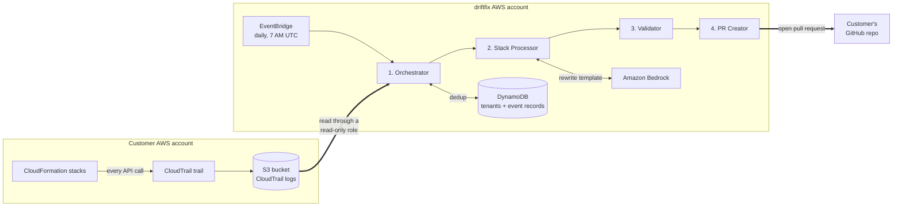
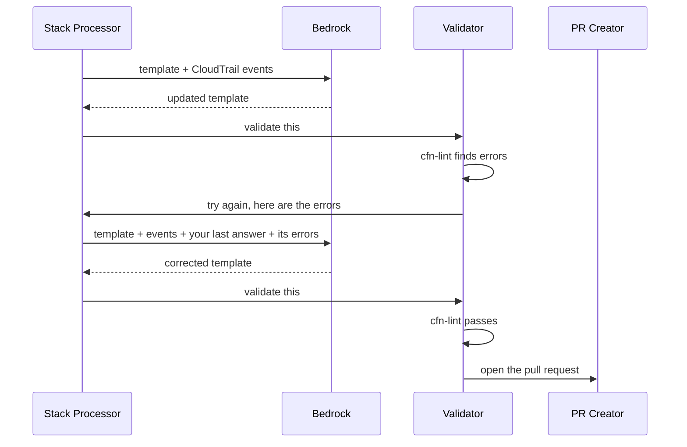
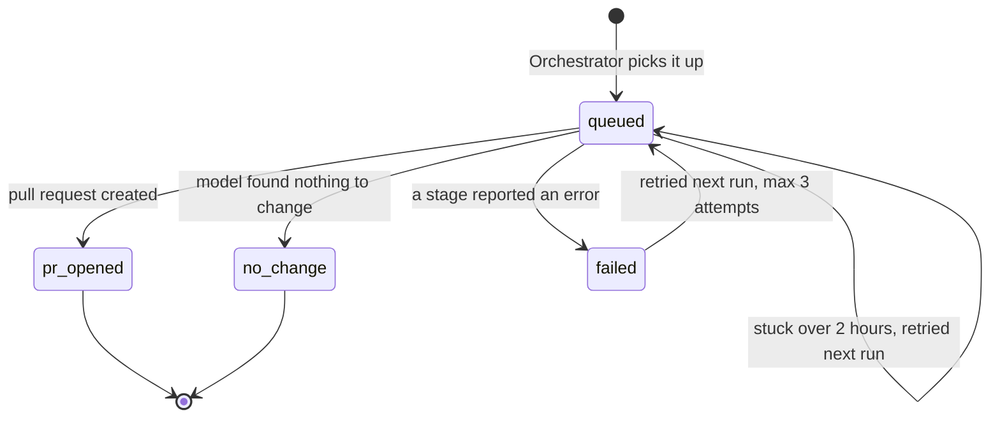
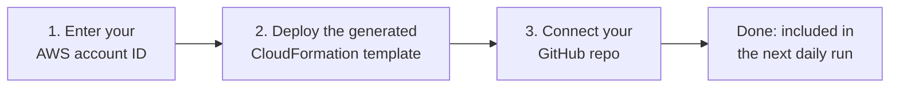

# driftfix

**Someone changed your AWS infrastructure by hand. driftfix notices, works out what the code should now say, and opens a pull request with the fix.**

It watches CloudTrail for manual changes to resources that CloudFormation manages, asks an LLM to update the template to match, checks the result with cfn-lint, and proposes it on GitHub for an engineer to review.

> Also known as the *IaC Drift Reconciliation SaaS*. Built as a team project by Abhishek Naresh Ahirrao, Kunal Elchipuram, and Ethan Machado.

---

## The problem: your code and your cloud stop agreeing

Infrastructure as Code makes one promise: the template in Git describes what is running. That promise breaks the first time someone fixes something in the AWS Console.

Picture a production incident. An engineer opens a port on a security group, or bumps an instance from `t3.large` to `t3.xlarge`, straight in the console because it is the fastest way. The incident ends. Nobody updates the template.



This gap is called **drift**, and it is quiet until it hurts. The next deploy from Git silently shrinks the instance back to `t3.large`, and the incident returns.

AWS can tell you that a stack has drifted. It does not write the fix. That is the part driftfix automates.

## What driftfix does about it

Once a day, for every customer, it runs three steps:

1. **Detect.** Read the customer's CloudTrail logs and pick out the manual changes to CloudFormation-managed resources.
2. **Fix.** Give the template and the evidence to an LLM on Amazon Bedrock, and get back an updated template.
3. **Propose.** Lint the result, then open a pull request that explains what changed and why.

A human always makes the final call. driftfix never changes infrastructure and never merges anything; it only opens pull requests.



### What the pull request looks like

For the resize above, the engineer who owns the stack finds this in their repository the next morning:

> **[Drift] ModifyInstanceAttribute detected on web**
>
> | Field | Value |
> |---|---|
> | Stack | `web` |
> | Event | `ModifyInstanceAttribute` |
> | Time | 2026-01-10T07:00:00Z |
> | Actor | `arn:aws:iam::111111111111:user/alice` |
> | Model confidence | 82% |
>
> **What changed** — Instance resized to t3.xlarge.
>
> **Root cause** — Manual resize in the console.
>
> **Files updated:** `stacks/web/prod.json`

Merging it brings Git back in line with reality. If the change was a mistake, closing the pull request and redeploying undoes the drift instead. Either way the gap is now visible.

---

## How it works

### Two AWS accounts, one narrow bridge

driftfix is multi-tenant. It runs in its own AWS account and reaches into each customer's account through a single read-only IAM role.



Three things keep customers isolated from each other:

- **Temporary credentials.** Each run calls STS `AssumeRole` and gets credentials that last one hour and work in exactly one customer account.
- **An ExternalId per customer.** The role can only be assumed with a secret value generated at onboarding, which blocks one customer from pointing driftfix at another's account.
- **Secrets stay in Secrets Manager.** GitHub tokens are fetched at runtime and never written to logs or to the tenants table.

### The pipeline, stage by stage

The work is split across four small Lambda functions. Each does one job and hands off to the next.

| Stage | Its job | The details that matter |
|---|---|---|
| **1. Orchestrator** | Find the manual changes | Reads the last 72 hours of CloudTrail logs. Keeps successful write calls only. Ignores changes made by CloudFormation itself, so a normal deploy is not mistaken for drift. Uses the `aws:cloudformation:stack-name` tag to work out which stack owns each resource. |
| **2. Stack Processor** | Write the fix | Fetches the template from GitHub together with the parameter files next to it, and sends them to Bedrock with the CloudTrail events. One invocation per stack, all in parallel. |
| **3. Validator** | Check the fix | Runs cfn-lint. If the template has errors, sends it back to the Stack Processor with the error list so the model can correct itself. |
| **4. PR Creator** | Propose the fix | Commits every changed file in one atomic commit on a `drift/...` branch and opens the pull request. |

Why parameter files? Because the value that drifted often does not live in the template. If `template.yaml` says `InstanceType: !Ref Size` and `prod.json` says `Size = t3.large`, the correct fix is one line in `prod.json`. Hard-coding `t3.xlarge` into the template would break every other environment. The model sees both files and returns only the ones it changed.

### When the model gets it wrong

LLMs sometimes produce a template that is not valid CloudFormation. driftfix treats that as a normal case, not a crash:



The loop runs at most three times. After that the events are marked `failed`, the invocation lands in the dead-letter queue, and an alarm fires. Only cfn-lint **errors** block a template; warnings are logged, because hand-written templates are full of warnings the model did not cause.

### How sure is the model?

Along with the template, the model returns a summary, a root cause, a confidence score between 0 and 1, and a flag saying whether a human should look closely. driftfix acts on that verdict:

| The model says | What driftfix does |
|---|---|
| "Here is the change", confidence 0.6 or higher | Opens a normal pull request, with the model's explanation in the description |
| "Here is the change, but check it", or confidence below 0.6 | Opens a pull request titled **`[Drift – needs review]`** with a warning banner listing the reasons |
| "The evidence is not enough to change anything" | Opens **no** pull request and records the reason |

The threshold is the `REVIEW_CONFIDENCE_THRESHOLD` environment variable on the Stack Processor.

### No event gets lost

Every CloudTrail event has a record in DynamoDB that tracks where it is in the pipeline:



This record is what makes the daily run safe to repeat. Finished events are skipped, so a pull request is never opened twice. Failed events are picked up again the next day, up to three attempts, which is why the lookback window is 72 hours and not 24. The rules live in one small file, [`lambdas/shared/reconciliation.py`](lambdas/shared/reconciliation.py).

For the full walkthrough of every step, see [`docs/system-architecture.md`](docs/system-architecture.md).

---

## Onboarding a customer

Customers sign themselves up through a small web portal, a React front end served by a FastAPI backend ([`ui/customer-portal/`](ui/customer-portal/), [`admin_ui/app.py`](admin_ui/app.py)).



The template from step 2 creates everything driftfix needs in the customer's account: a CloudTrail trail that records write events, an S3 bucket for the logs, and the read-only cross-account role. The same resources are available as Terraform in [`terraform/customer/`](terraform/customer/).

The portal is packaged with Docker, pushed to Amazon ECR and hosted on AWS App Runner. The course deployment ran at `https://fxcbu33sqc.us-east-1.awsapprunner.com/portal/`. The customer-facing guide is [`docs/customer-onboarding.md`](docs/customer-onboarding.md).

---

## What it is built with

| Service | What it does here |
|---|---|
| **AWS Lambda** | The four pipeline functions plus a health check |
| **Amazon Bedrock** (Nova Lite by default) | The LLM that rewrites templates from CloudTrail evidence |
| **AWS CloudTrail** | The source of truth: a log of every API call in the customer's account |
| **Amazon DynamoDB** | `drift-detector-tenants` holds customer config; `drift-detector-reconciliations` holds one record per event |
| **Amazon S3** | CloudTrail logs on the customer side; validated templates on the driftfix side |
| **Amazon EventBridge** | The daily trigger, `cron(0 7 * * ? *)`, and the 5-minute health check schedule |
| **Amazon SQS** | Dead-letter queue for failed invocations |
| **Amazon CloudWatch + SNS** | Dashboards, alarms, metric filters, and alarm notifications |
| **AWS Secrets Manager** | GitHub tokens |
| **AWS STS + IAM** | Cross-account access with temporary credentials; one role per Lambda |
| **AWS App Runner + Amazon ECR** | Hosting and image registry for the customer portal |
| **Terraform** | All of the above, defined in [`terraform/`](terraform/) |

---

## Knowing when something breaks

A pipeline that runs once a day can fail without anyone noticing, so a separate **Health Check Lambda** runs every 5 minutes. It probes each Lambda function, both DynamoDB tables, the audit bucket and the dead-letter queue, and publishes a `drift-detector/HealthCheck` metric for each: `1` is healthy, `0` raises an alarm.

Three CloudWatch dashboards sit on top of that:

| Dashboard | Use it to answer |
|---|---|
| `drift-detector-status` | Is everything up right now? The best place to start. |
| `drift-detector-overview` | How is the pipeline performing? Invocations, errors, p95/p99 duration, throttles, cold starts, concurrency. |
| `drift-detector-cost` | What is this costing? Lambda compute estimate for the selected time window. |

There are 17 alarms in total: 8 for component health and 9 for pipeline behaviour (errors, throttles, timeouts, dead-letter queue depth). All of them notify through SNS. Details are in [`docs/observability.md`](docs/observability.md).

---

## How we tested it

### Load tests

On 2026-05-04 we ran five scenarios against a real customer account with 10 CloudFormation stacks. A script ([`scripts/load_test/run_load_test.sh`](scripts/load_test/run_load_test.sh)) caused real drift by calling AWS APIs directly, such as `PutBucketEncryption` and `ModifyDBInstance`, and then we triggered the Orchestrator by hand.

| Scenario | Stacks | The question it answers |
|---|---|---|
| T1 — Functional | 1 | Does the whole pipeline work end to end? |
| T2 — Scaling | 3 | Do stacks really run in parallel? |
| T3 — Performance | 10 | How fast is it at peak load? |
| T4 — Failure | 10 + 1 broken tenant | Does one bad customer block the others? |
| T5 — Security | 6 | Do any secrets leak into the logs? |

**It scales without tuning.** Lambda concurrency matched the number of drifted stacks exactly, from 1 to 10, with zero throttles and zero errors. Throughput rose from about 16 stacks per minute to about 39.5.


**The bottleneck is the LLM, not our code.** Median Bedrock latency held steady at 4–5 seconds at every load level. The slowest calls did not: P99 grew from 1.7 seconds with one stack to 14.9 seconds with ten, as parallel requests competed for inference capacity.


**A broken tenant stays contained (T4).** We added a tenant with an invalid IAM role. The Orchestrator logged the error and moved on, and all 10 valid stacks finished normally.

**Nothing sensitive is logged (T5).** We searched every Lambda log group for `AKIA`, `ghp_`, `password`, `secret_key` and `aws_secret` and found no matches.

The full report, with all seven graphs and the raw CloudWatch exports, is in [`results/report.md`](results/report.md).

### Breaking it on purpose

Three scripts in [`tests/failure_scenarios/`](tests/failure_scenarios/) each cause one kind of failure and check that the monitoring catches it.

| Scenario | What we break | What we expect to see | Dead-letter queue |
|---|---|---|---|
| **1. Poison pill** | Send the Validator a template with four cfn-lint violations | 3 Lambda errors, `drift-detector-validator-errors` alarm | 1 message |
| **2. Throttle** | Fire 40 invocations at a concurrency limit of 10 | About 30 throttles, `drift-detector-validator-throttled` alarm | About 10 messages |
| **3. Degraded zone** | Cut the Validator's memory to slow it down, imitating a struggling availability zone | Slower p99 duration, but zero errors | None |

Each scenario is written up in [`tests/failure_scenarios/README.md`](tests/failure_scenarios/README.md).

### Unit tests

The pipeline's decision logic has unit tests that need no AWS account:

```bash
pip install boto3 pytest
```

```bash
pytest tests/unit
```

They cover which events count as drift, when an event is retried, how the model's reply is parsed, the lint retry loop, and what ends up in the pull request.

---

## Running it yourself

You need an AWS account with Bedrock model access, Terraform 1.5 or newer, and an S3 bucket to hold the Lambda zip files.

Package the Lambdas and upload them:

```bash
./scripts/package_lambdas.sh <your-lambda-zip-bucket>
```

Then copy `terraform/saas/terraform.tfvars.example` to `terraform.tfvars`, fill it in, and deploy:

```bash
cd terraform/saas && terraform init && terraform apply
```

The four pipeline Lambdas pass work to each other, so always deploy them together.

---

## What is not done yet

This started as a course project, and some things are not production-ready:

- **The portal has no login.** Anyone who can reach it can list, add and remove tenants. Put it behind authentication before exposing it.
- **Templates that are not in GitHub.** If the template cannot be found in the customer's repository, driftfix falls back to the copy CloudFormation holds and proposes it as `template.yaml` at the repository root, which may not be where the customer keeps it.
- **Tenants run one after another** inside a single 15-minute Orchestrator invocation, which caps how many customers one run can serve.
- **No CI.** The unit tests are run by hand.

---

## Repository layout

```
.
├── lambdas/
│   ├── processor/          Orchestrator: reads CloudTrail, finds drift, fans out per stack
│   ├── stack_processor/    Fetches the template, calls Bedrock, decides what to do with the answer
│   ├── validator/          Runs cfn-lint and drives the retry loop
│   ├── pr_creator/         Commits the changed files and opens the pull request
│   ├── health_check/       Probes every component every 5 minutes
│   └── shared/             Event status lifecycle, packaged into every Lambda
├── admin_ui/               FastAPI backend for the customer portal
├── ui/customer-portal/     React + Vite + Tailwind front end
├── terraform/
│   ├── saas/               driftfix's own infrastructure, dashboards and alarms
│   └── customer/           What a customer deploys: CloudTrail, S3, cross-account role
├── tests/
│   ├── unit/               Unit tests, no AWS needed
│   ├── e2e.py              End-to-end test against a deployed pipeline
│   └── failure_scenarios/  The three break-it-on-purpose scripts
├── scripts/
│   ├── package_lambdas.sh  Builds and uploads the Lambda zips
│   └── load_test/          Load test runner and graph generation
├── results/                Load test report, graphs G1–G7, raw metric exports
├── docs/                   Architecture, onboarding and observability guides
├── Dockerfile              Portal image: React build + FastAPI
└── .env.example
```

---

## Team

Built by Abhishek Naresh Ahirrao, Kunal Elchipuram, and Ethan Machado.

<details>
<summary>Who did what</summary>

### Abhishek Naresh Ahirrao

- Designed the end-to-end multi-tenant SaaS architecture with idempotency and tenant isolation as core constraints.
- Designed the four-stage asynchronous Lambda pipeline, EventBridge scheduling, DynamoDB deduplication, S3 handoff, and SQS DLQ flow.
- Authored and deployed the Terraform configuration covering Lambda, IAM, DynamoDB, SQS, CloudWatch, and EventBridge.
- Created architecture diagrams illustrating the two-account topology, pipeline sequence, and concurrency fan-out.
- Wrote the architecture, scaling, and cost analysis sections of the technical report.
- Designed cross-account IAM using STS AssumeRole with ExternalId protection and per-invocation session renewal.

### Kunal Elchipuram

- Designed and implemented the customer-facing onboarding portal frontend, including the onboarding forms and guided customer setup flow.
- Updated the customer onboarding CloudFormation template to support self-service tenant onboarding.
- Dockerized the customer portal application and deployed it through Amazon ECR and AWS App Runner.
- Executed the five structured load test scenarios covering functional correctness, scaling, failure isolation, security, and performance.
- Collected, analyzed, and presented the performance metrics used in the report and presentation, including latency, throughput, concurrency, and resource utilization.
- Experimented with and evaluated different Amazon Bedrock models for deployment suitability.
- Configured the Bedrock integration in the Stack Processor Lambda for LLM-based CloudFormation template generation.
- Helped write the related components in the report and presentation slides.

### Ethan Machado

- Created the example customer repository, including the CI/CD pipeline and CloudFormation test stacks.
- Created and executed the dedicated failure scenarios.
- Created three CloudWatch dashboards for service status, operations overview, and cost visibility.
- Implemented CloudWatch alarms and the SNS email notification topic.
- Implemented recurring health checks for major pipeline components.
- Implemented write-only management log filtering on the customer tenant side.
- Created and collaborated on several presentation slides.
- Presented the introduction, customer-side system demo, and failure scenario sections.
- Helped write the Abstract, Problem Definition, Motivation, Related Work, Implementation Details, Failure Modeling, Architectural Trade-Off Analysis, and Conclusions sections of the final report.

</details>
